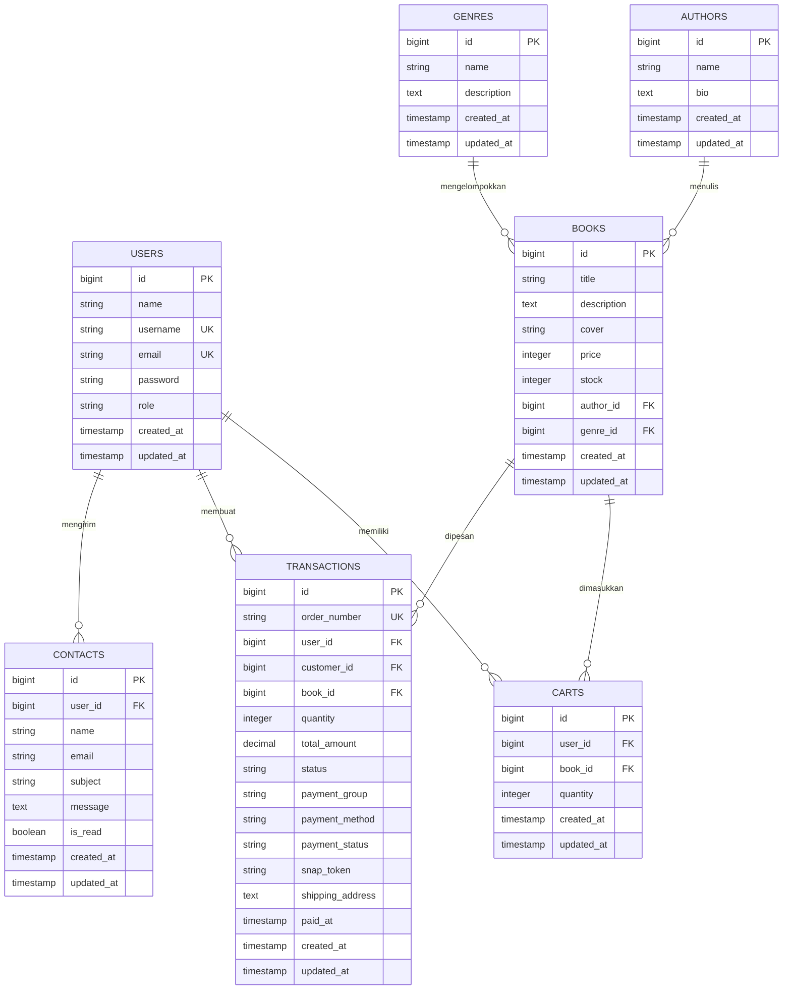

# ERD BookStore

Diagram ini menggambarkan tabel utama yang digunakan aplikasi BookStore.

## Penjelasan Relasi

- Satu user dapat memiliki banyak item keranjang.
- Satu user dapat membuat banyak transaksi.
- Satu user dapat mengirim banyak pesan kontak.
- Satu author dapat memiliki banyak buku.
- Satu genre dapat digunakan oleh banyak buku.
- Satu buku dapat muncul di banyak keranjang user.
- Satu buku dapat dipesan dalam banyak transaksi.

## Sumber Struktur Database

Struktur ERD ini dibuat berdasarkan migration Laravel di folder
`database/migrations`.
